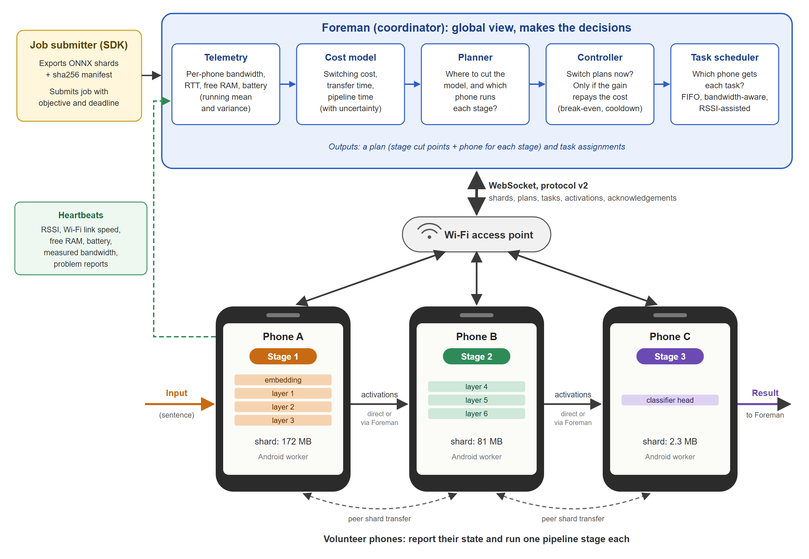

# CROWDio v2: Reconfiguration-Aware Planning and Network-Aware Scheduling for Pipelined Neural Network Inference on Volunteer Smartphones

*Revised after comments from Seng Loke (25 Nov 2026). Changes: definitions added (Section 1.1), an architecture figure (Section 3.0), the oracle and seed counts corrected, the base-case oracle figure made consistent, the real-device runs and the cold/warm terms explained, and a discussion of top-down and bottom-up (Honeybee-style) scheduling added (Section 6).*

---

## 1. Summary

CROWDio runs neural network inference on a group of volunteer smartphones. It splits a model into consecutive pieces (*shards*), places each shard on a phone, and passes each input through the phones in order, like an assembly line (*pipelining*). A central coordinator, the **Foreman**, decides which phone holds which shard and which phone gets each task. This report covers three additions: accounting for the cost of changing the deployment at runtime, handling devices whose memory is too small for the model, and using network information when assigning tasks.

The main results so far:

- **Planning under switching cost.** A planner and a switching controller decide where each shard runs. They switch to a new placement only when the expected time saved is larger than the cost of reloading shards. In a trace-driven simulation (5 phones, one link degrading and one phone leaving), the proposed policy finished within 2.9% of an *oracle* policy and 45% faster than a fixed partition. (The oracle sees the true state of every phone and re-plans whenever that pays off; see Section 1.1.)
- **Adaptive model sizing.** The planner reads the free memory on each phone and picks the highest-quality model version that fits: full precision (fp32), half precision (fp16) or 8-bit integer (int8). This lets the system keep running when the full model does not fit on the phones.
- **When network-aware scheduling helps.** A network-aware scheduler sends each task to the phone expected to finish it soonest, counting the time to transfer its data. The baseline is FIFO, which gives the next task to whichever phone becomes free first. We ran 48 simulated network conditions, each repeated with 30 random seeds (10 and 7 seeds for the two 100-phone conditions). In the *base case* (12 walking phones, 8 tasks each; Section 4.4), it finishes the whole job **4.1%** sooner than FIFO. An oracle that knows each phone's true current bandwidth finishes **5.8%** sooner. The gain is about **30%** when each phone receives only one task. It is close to zero when link speeds change faster than the phones report them. The oracle gains most, up to 14%, where link speeds differ widely and transfers take a large share of each task's time. In that same regime the scheduler's bandwidth estimates are least accurate. **RSSI** (Wi-Fi signal strength) did not improve on a measured bandwidth value. It helped only as a calibrated first guess for phones whose bandwidth had not been measured yet. All of these results come from simulation and have not yet been checked on real phones.
- **Real-device validation.** DistilBERT (66M parameters, 255 MB) split across three Android phones classified 700 sentences with no lost results and 91.1% accuracy. This matches the published accuracy of about 91% for the unsplit model. The planner and controller have also completed one end-to-end run with BERT-base (110M parameters, 418 MiB) on three phones (40 requests, all completed).

### 1.1 Terms used in this report

| Term | Meaning here |
|---|---|
| **Shard / stage** | A shard is a run of consecutive model layers exported as one ONNX file. A stage is one step of the pipeline, made of one or more shards on one phone. A *plan* gives the cut points and the phone for each stage. |
| **Atom** | The smallest layer group the exporter can cut, for example one transformer block. A shard is a run of atoms. BERT-base has 24 atoms. |
| **Reconfiguration / switch** | Changing the plan while the system is running. This means unloading the old shard on a phone, downloading the new one if it is not already on disk, writing it, loading it and initialising it. |
| **Task** | One unit of work given to one phone. For the pipelined DNN, one sentence through three shards creates three tasks. In the network simulator, a task is a download, then compute, then a result upload. |
| **Makespan** | Time from when the first task of a job is released until the last result is back at the Foreman. Smaller is better. |
| **FIFO (baseline)** | First-in, first-out. Tasks wait in arrival order, and the next one goes to whichever phone becomes idle first, regardless of its network. It is the Foreman's default and the simplest policy that already balances load, since faster phones come back for more work sooner. A network-aware scheduler is useful only if it beats FIFO. |
| **Gain over FIFO** | 1 − (makespan of scheduler ÷ makespan of FIFO) for the same seed. +5% means the job finished 5% sooner than under FIFO. |
| **Oracle (network study)** | The bandwidth-aware scheduler given the true current bandwidth of every phone at the moment it decides, instead of the phones' reported values. It cannot see the future, and it uses the same greedy rule as the real scheduler. It shows how much better estimates could gain. It is not the optimal schedule and cannot be built in practice. Because its rule is greedy, the real scheduler can occasionally beat it (+30.4% against +28.9% with one task per phone). |
| **Oracle (reconfiguration study)** | The switching controller given the true state of every phone (no measurement noise or delay), with no safety margin or cooldown, re-evaluated every second. It does not know about future link drops or departures. Regret = a policy's total time minus the oracle's. |
| **Base case** | The default network-simulator setting from which one parameter is varied at a time: 12 phones, walking speed (1.4 m/s), moderate link heterogeneity (backhaul caps spread 5×, phones within 40 m of the access point), a median 20 Mbit/s backhaul cap per phone, no contention or network events, bandwidth reports every 10 s, 8 tasks per phone, and transfer time about half of compute time. |
| **Transfer-to-compute ratio** | Expected time to move a task's data divided by its compute time. Higher values mean the network matters more. |
| **Link heterogeneity** | How much the phones' achievable bandwidths differ. *Identical*: all phones close to the access point with the same cap. *Moderate*: caps spread 5×. *Extreme*: about 50× spread, with phones up to 80 m away. |
| **Paired seeds** | For each seed, every scheduler runs on exactly the same simulated world, the same tasks and the same report noise. Differences between schedulers therefore come only from their decisions. |
| **95% bootstrap interval, `*`** | An uncertainty range for the median gain, from resampling the seeds 4,000 times. `*` marks a range that does not include zero, meaning the gain is unlikely to be chance. |
| **RSSI** | Received signal strength indicator, the Wi-Fi signal strength in dBm, reported by each phone with its heartbeat. Closer to 0 is stronger (−50 dBm is strong, −85 dBm is weak). |
| **Heartbeat** | A periodic status message from a phone to the Foreman containing RSSI, link speed, free RAM, battery and, when available, measured bandwidth. |
| **Scheduler window** | The maximum number of queued tasks the scheduler places in one decision. |
| **Cold / warm** | *Cold*: the phones do not yet have the shards, so the first requests wait for downloads and model loading. *Warm*: the shards are already loaded, so only inference and data transfer remain. |
| **Protocol v2** | Version 2 of the Foreman–phone message protocol, added for planned inference. It defines typed and versioned messages for loading, prefetching and running shards, probing links, fetching a shard from a peer phone, rerouting, and reporting problems (for example out of memory or a down next hop). Messages carry identifiers, acknowledgements and retries. A phone declares at connection time which messages it supports, and older (v1) phones are never given planned work. |

## 2. Motivation

The first version of CROWDio (arXiv 2604.19363; ICML workshop paper, arXiv 2605.20723) showed that a model can be split into a fixed set of shards and pipelined across volunteer phones. It left three problems open. Each is followed by how this work addresses it.

1. **Reconfiguration is expensive.** Moving a shard to another phone means unloading, downloading, writing and loading it, which can take tens of seconds. A planner that ignores this cost re-plans too often.
   *Approach:* include the switching cost in every decision and switch only when the expected saving over the remaining work exceeds it (break-even rule, Section 3.1). Prefer phones that already hold a shard. Prefetch shards in the background so that the old plan keeps serving while the new one loads.
2. **Devices differ and change over time.** Bandwidth, free memory, battery and temperature differ between phones and change while the system runs, so a partition chosen once becomes out of date.
   *Approach:* keep running estimates of each phone's state (telemetry). Re-plan when they drift, and assign individual tasks using current network estimates (network-aware scheduling, Section 3.3).
3. **Memory is the binding constraint.** When the phones together cannot hold the model, a fixed partition fails.
   *Approach:* choose among model versions of different size (adaptive model sizing, Section 3.2).

## 3. System Overview

### 3.0 Architecture

```
                         ┌──────────────────────── Foreman (laptop/server) ─────────────────────────┐
  Job submitter (SDK)    │                                                                          │
  - model export ──────► │  Telemetry ──► Cost model ──► Planner ──► Controller ──► Plan (stages)   │
    (ONNX shards,        │  (bandwidth,    (switch,       (where do   (switch now   │               │
    manifest)            │   RTT, RAM,      transfer,      shards go?) or not?)      ▼               │
  - submit job ────────► │   battery)       pipeline)                       Task scheduler          │
    (objective,          │      ▲                                    (which phone gets this task?)  │
    deadline)            │      │ heartbeats (RSSI, link speed, RAM, battery, bandwidth)            │
                         └──────┼─────────────────────────────┬────────────────────────────────────┘
                                │      WebSocket, protocol v2  │  shards, tasks, activations
                    ┌───────────┴──────────────────────────────┴────────────┐
                    │                  Wi-Fi access point                    │
                    └──────┬──────────────────┬──────────────────┬───────────┘
                           │                  │                  │
                    ┌──────▼─────┐     ┌──────▼─────┐     ┌──────▼─────┐
     input ───────► │  Phone A   │ ──► │  Phone B   │ ──► │  Phone C   │ ───► result
     (sentence)     │ stage 1    │     │ stage 2    │     │ stage 3    │      (to Foreman)
                    │ embedding +│     │ layers 4–6 │     │ classifier │
                    │ layers 1–3 │     │ (81 MB)    │     │ (2.3 MB)   │
                    │ (172 MB)   │     │            │     │            │
                    └────────────┘     └────────────┘     └────────────┘
                     activations travel through the Foreman or directly phone-to-phone
                     (peer service); phones can also fetch shards from each other
```

*Figure 0. CROWDio v2. The Foreman holds the global view and decides; phones report and execute. Real-device runs used three Samsung SM-A366E phones on one Wi-Fi network, with the Foreman on a laptop on the same network. The shard sizes are those of the DistilBERT run in Section 4.1.*



*Drawn figure: `docs/figures/architecture.svg` (vector) and `docs/figures/architecture.png` (2400×1660).*

### 3.1 Planning and control (Foreman)

- **Telemetry.** For each phone, a running mean and variance of bandwidth and round-trip time, with the number of samples and their age. Measurements come from normal traffic first, plus a limited number of active probes.
- **Cost model.** Estimates (a) the switching cost under *single residency*, meaning a phone holds one loaded shard at a time, so a switch is unload, fetch or write if not on disk, load and initialise; (b) the time to fetch a shard from the Foreman or from a peer phone; (c) activation transfer through the Foreman versus directly between phones; and (d) pipeline time with uncertainty bounds.
- **Planner.** The planner searches for the best *plan*: where to cut the model into stages, and which phone runs each stage, so that estimated pipeline time (and switching cost) is minimal. It has three exact or near-exact search methods: exhaustive enumeration, a Pareto dynamic programme (exact, keeps several trade-offs), and a faster scalar dynamic programme. It picks one based on problem size, so that BERT-base (24 atoms) stays fast. Between full searches, a local search makes small changes to the current plan: replace a phone, swap two phones, move a cut point, merge or split stages, or repair the plan after a phone leaves.
- **Controller.** Decides *when* to change plans. Re-planning is triggered by drift in the estimates, a phone joining or leaving, deadline risk, a growing queue and problem reports from phones. Under the break-even rule, the controller switches only if the new plan's cost, including switching cost and a safety margin, is lower than the cost of staying on the current plan. A cooldown and a cap on the number of switches prevent oscillation. Losing a phone or running out of memory forces an immediate re-plan. A rent-or-buy regret rule is available as an alternative.
- **Memory and disk.** Cut points follow the free RAM each phone reports, and the plan is re-made when a phone runs low. Shards cached on disk are evicted least-recently-used first.
- **Protocol v2.** See Section 1.1.

### 3.2 Adaptive model sizing

The planner could already make shards smaller to fit each phone, but this does not help once the whole model is larger than the phones' combined memory. Adaptive model sizing adds a list of model versions ordered by quality: fp32, then fp16, then int8, or a smaller model family such as DistilBERT instead of BERT-base. The weights of these versions are ×1, ×0.5 and ×0.25 of the fp32 size. The int8 version uses dynamic quantisation, adds about 2% for scales and zero points, and keeps activations in fp32. The procedure:

1. Compute each phone's usable capacity: free RAM × (1 − headroom), plus the size of any shard already loaded.
2. Rule out versions that cannot fit, using a quick check before the slower search. A version is rejected if its smallest possible split is larger than the combined capacity, or if some atom fits on no phone.
3. Plan the highest-quality version that fits. If a deadline is given, fall back to the fastest version that fits.
4. Move up to a larger version only when it still fits after holding back an extra fraction of each phone's free RAM (the *upgrade margin*), to avoid switching back and forth. The margin is added to the headroom in step 1. It is 20%, chosen because free RAM on the real phones dipped 7–23% below its average during runs (about 3,550 heartbeats per phone), so a smaller margin would allow an upgrade followed by an immediate downgrade. Move down immediately, with no margin.

*Note: this is decided centrally from what phones report. A bottom-up alternative is discussed in Section 6.*

### 3.3 Network-aware scheduling

The network-aware scheduler estimates each candidate phone's completion time for a task as round-trip time, plus time to download any data the phone does not already hold, plus compute time, plus time to upload the result. It sends the task to the phone with the earliest estimated finish. It maps tasks in batches (the window), includes a guard against starving slow phones, and shares a common Wi-Fi link fairly between phones. There are two variants: **bandwidth-only**, which uses measured bandwidth, and **RSSI-assisted**, described below. An **adaptive** scheduler adds penalties for unreliable phones and low battery.

**RSSI-assisted estimation.** Phones report a measured bandwidth only after a large timed transfer, so between transfers the estimate can be minutes old. RSSI arrives with every heartbeat. The RSSI-assisted variant keeps measured bandwidth as its main input and uses RSSI to fill the gaps:

| Situation | What the scheduler uses |
|---|---|
| Recent bandwidth measurement, signal steady | Measured bandwidth only (same as bandwidth-only) |
| Phone not yet measured | Expected bandwidth for its RSSI, capped by its Wi-Fi link speed |
| Signal fell by at least 4 dB since the last measurement | Measured bandwidth scaled down by the predicted loss |
| Signal below −82 dBm | Estimated cost × 1.5 (near the edge of coverage) |
| No RSSI, or RSSI older than 60 s | Bandwidth-only behaviour |

RSSI never raises an estimate above a measured value, so an improvement must be measured before it is believed. Expected bandwidth comes from a log-linear RSSI-to-throughput curve, in which throughput falls tenfold every 20 dB. The default curve parameters are placeholders. A calibration function fits the curve from the heartbeat logs of real runs.

### 3.4 Network simulator and regime study

Running dozens of network conditions with repeats on real phones is not feasible yet, so a network simulator was built. It runs the **real scheduler code** on simulated phones and varies the parameters that decide whether network awareness matters.

- **Physical model.** Phones move by random-waypoint mobility at a chosen speed. RSSI follows log-distance path loss with shadow fading (correlated over 8 m of movement) and fast fading. The link rate follows a capped Shannon-style curve. Achievable throughput is the lower of (a) the link rate minus airtime used by other devices and (b) a per-phone backhaul cap. The backhaul cap, contention, interference bursts and throttling do **not** show in RSSI, but handoff outages do. This separation is deliberate: on real phones RSSI and actual throughput can disagree (Section 5).
- **What the scheduler sees.** Only what phones report: bandwidth in heartbeats every 1, 10 or 60 s (with 8% noise), or a rate measured after a large transfer (as the Android app does), plus RSSI every 5 s. The oracle gets the true current rates. Each scheduler's estimate error is logged. There is no limit on dispatch rate, so differences come from placement alone.
- **Sweep design.** 48 conditions with 30 paired seeds each (10 and 7 for the two 100-phone conditions), grouped as follows:

| Group | Values | Conditions |
|---|---|---|
| Base case | see Section 1.1 | 1 |
| Transfer-to-compute ratio | 0.05, 0.1, 0.25, 1, 2 | 5 |
| Payload size (ratio fixed at 0.5) | 20 KB, 200 KB, 2 MB, 20 MB | 4 |
| Tasks per phone | 1, 2, 4, 16 | 4 |
| Link heterogeneity | identical, extreme | 2 |
| Mobility | static, vehicular 20 m/s | 2 |
| Report freshness | every 1 s, every 60 s, after transfers only | 3 |
| Cold start (reports after transfers only) | 1, 2, 4 tasks per phone | 3 |
| Contention | 30%, 60% airtime | 2 |
| Backhaul cap | 5, 100 Mbit/s, none | 3 |
| Network events | handoff outages, interference bursts, 25% throttled | 3 |
| Fleet size | 3, 10, 30, 100 (window 24); 30, 100 (window = fleet) | 6 |
| Regime map (ratio × heterogeneity) | the cells not already listed above | 10 |
| **Total** | | **48** |

  Each group is plotted as one panel of Figure 2. The regime map is Figure 1.
- **Validating the simulator.** A first version delivered the phones' first heartbeats only after the first tasks were assigned, which biased the comparison against the network-aware schedulers. A test caught this and the sweep was rerun. Twenty tests cover the model, transfers over time-varying rates, the simulator and the statistics.

The device simulator used in the earlier fleet experiments (Section 4.4) uses a different RSSI slope (25 dB per tenfold drop) from the scheduler's default curve (20 dB), so the scheduler is never given the simulator's own model.

### 3.5 Mobile worker, SDK and evaluation tooling

- **Android worker** implementing protocol v2, with a peer service for phone-to-phone shard transfer.
- **SDK** that exports an ONNX shard for every contiguous layer range plus the full model, checks each against PyTorch, records it in a sha256 manifest, and accepts job submissions with an objective and a deadline.
- **Evaluation tools**: a trace-driven planner simulator, a virtual phone fleet that connects to the real Foreman over its WebSocket protocol, the network simulator above, and experiment scripts that log signal strength, link speed, free RAM and battery.

## 4. Evaluation

Real-phone experiments used three identical Samsung SM-A366E phones (8 cores at 1.8 GHz, 7.3 GB RAM) on one Wi-Fi network, placed at fixed positions near the access point (RSSI about −56 dBm). All real-phone figures are from single runs unless repeats are stated.

### 4.1 Real devices: DistilBERT with a fixed three-shard split

DistilBERT fine-tuned on SST-2 (sentence sentiment, positive or negative) was split into shards of 172 MB, 81 MB and 2.3 MB and run with the network-aware scheduler. Each sentence passes through all three shards, so 30 sentences create 90 tasks.

| Run | What it is | Sentences | Wall time (s) | Throughput (sent./s) | Returned | Accuracy |
|---|---|---|---|---|---|---|
| Full | 700 sentences from the SST-2 validation set | 700 | 680.9 | 1.03 | 700 / 700 | 91.1% |
| Medium | First 100 of those sentences | 100 | 88.7 | 1.13 | 100 / 100 | 94.0% |
| Cold baseline | 30 sentences, phones had to download and load shards first | 30 | 47.5 | 0.63 | 30 / 30 | 96.7% |
| Warm baseline (2 runs) | Same 30 sentences, shards already loaded | 30 | 15.3 / 31.9 | 1.96 / 0.94 | 30 / 30 | 96.7% |
| One phone, light load | One phone also runs a light CPU-load generator while working | 30 | 27.4 | 1.09 | 30 / 30 | 96.7% |
| One phone, heavy load | Same with a heavy load generator | 30 | 95.3 | 0.32 | 30 / 30 | 96.7% |

Accuracy on the full 700 sentences (91.1%) matches the roughly 91% published for the unsplit model. Splitting the model therefore did not change its predictions. The higher figures on 30 and 100 sentences reflect easier small subsets, not a better model. The two warm runs differ by 2× with identical settings, which shows high run-to-run variance and is why repeats are needed (Section 7).

Under heavy load, the scheduler cut the loaded phone's share from 25 to 11 of the 90 tasks. Another phone took 51. All results were still returned. Four tasks failed across the 100- and 700-sentence runs, all with an empty-model download error on one shard, and all succeeded on retry. The cause is not yet known.

### 4.2 Real devices: BERT-base in planned mode

This was the first run of the planner, controller and protocol v2 on real phones, using the reconfiguration-aware policy. The planner chose a three-stage plan. Loading the first plan took 116.8 s, mostly shard download (about 1.8–2.1 MB/s, or 15–17 Mbit/s, per phone). Writing, loading and initialising a shard together took under 0.8 s, far below the 48 s (cold) and 6 s (warm) placeholder values the cost model assumed.

| Job | Requests | Latency min / median / max (s) | Accuracy |
|---|---|---|---|
| Cold: sent while shards were still loading | 10 | 118.6 / 118.9 / 120.1 | not scored |
| Warm: sent after loading finished | 30 | 2.1 / 5.5 / 8.9 | 28 / 30 (93.3%) |

All 40 requests completed. Over the 2.4 hours the Foreman ran, the controller made 7,059 decisions and switched plans once, for the initial deployment. There was **no oscillation**, but this run did not test for it. The phones were identical, did not move, and had steady links, and no phone joined or left. No alternative plan therefore came close to beating the current one by more than the switching cost plus the margin. A real test of oscillation needs link degradation and churn on the phones (Section 7).

### 4.3 Simulation: reconfiguration policies

A trace-driven simulator ran the three-shard DistilBERT export on 5 phones with 700 requests. One phone's link dropped to 150 kB/s at t = 120 s, and another phone left at t = 400 s. Phase times are placeholder values, not measurements. Regret is a policy's total time minus the oracle's (Section 1.1).

| Policy | Total (s) | Regret (s) | Switches | Wasted switches | Stall (s) | Shard data moved (MB) |
|---|---|---|---|---|---|---|
| Oracle (true state, zero margin) | 388.5 | 0 | 1 | 0 | 1.9 | 2.4 |
| Runtime adapter, asynchronous switch | 397.0 | 8.5 | 1 | 0 | 0.0 | 267.9 |
| **Proposed (switching-cost-aware)** | 399.6 | 11.1 | 1 | 0 | 1.8 | 2.4 |
| Full-model replicas where they fit | 430.1 | 41.6 | 1 | 0 | 1.1 | 267.9 |
| Load time in objective, one shot | 430.6 | 42.1 | 1 | 0 | 1.9 | 267.9 |
| Runtime adapter, synchronous switch | 440.5 | 51.9 | 1 | 0 | 42.5 | 267.9 |
| Re-plan every epoch, ignore switch cost | 546.4 | 157.9 | 3 | 1 | 168.6 | 631.1 |
| Fixed partition | 722.6 | 334.1 | 1 | 0 | 1.0 | 2.4 |

The proposed policy came within 2.9% of the oracle and moved only 2.4 MB of shard data. The asynchronous runtime adapter was 2.6 s faster, but it moved 267.9 MB and needs memory for two model sessions on one phone. Ignoring switching cost caused a wasted switch and 168.6 s of stall. In a healthy run without faults, enabling all v2 features gave the same total time as the baseline (386.4 s against 386.7 s), with about twice the control traffic.

### 4.4 Simulation: network-aware scheduling

**Early experiments (small samples).** On a scheduler simulator with 6 workers (links 0.5–20 MB/s, 24 mixed tasks, 30 random layouts), the network-aware scheduler had a mean makespan of 4.23 s, against 8.4–9.9 s for FIFO, round-robin and least-loaded. With identical links, all schedulers were similar (4.27–4.50 s). *Caveat: this simulator gave the scheduler the true link rates. It therefore shows that the scheduling rule works when it is given correct bandwidth figures. It does not show that the system can measure those figures correctly on real phones. The regime study below tests that.*

On a virtual fleet of 15 phones connected to the real Foreman (150 mixed tasks, 3 runs per scheduler), with fresh bandwidth in every heartbeat, the bandwidth-based scheduler's makespan was 20.0% shorter than FIFO's when the fastest third of phones lost bandwidth, and 17.3% shorter under churn. The adaptive scheduler did not help: it was 1.5% slower than FIFO under link drop and 30.9% slower under churn, for reasons not yet known. These figures come from three runs each, and from fresh bandwidth reports that the Android app does not provide. A follow-up with out-of-date reports and RSSI-assisted scheduling, also three runs, showed no difference beyond noise. **The regime study below replaces these results.** It puts the base-case gain at about 4%, not 20%, and it found no advantage for the RSSI-assisted variant over bandwidth-only.

**Regime study.** The earlier comparison was too small, and its simulator derived RSSI from the true link rate, so RSSI predicted bandwidth perfectly by construction. The regime study (Section 3.4) replaces it. The base case is defined in Section 1.1. In the tables, `*` marks a 95% interval that excludes zero, and in Figure 1 "n.s." marks one that includes zero. "Bandwidth-aware" means the bandwidth-only scheduler, and "RSSI (calibrated)" means the RSSI-assisted scheduler with a fitted curve.

**Short answer.** Network awareness helps modestly in most regimes and a lot in one. The oracle gains 5.8% over FIFO in the base case, 11.5% under 50× link heterogeneity and 29% with one task per phone. The real scheduler captures part of that, but none of it where links change faster than reports arrive. RSSI helps only as a calibrated first guess before any bandwidth has been measured.

*Figure 1. Regime map: median gain over FIFO (%) for the bandwidth-aware, calibrated RSSI and oracle schedulers, by transfer-to-compute ratio (columns) and link heterogeneity (rows), paired over 30 seeds. "n.s." marks cells whose 95% interval includes zero. Other settings as in the base case.*

The oracle's gain grows along both axes, from about +3% (identical links, small transfers) to +14% (extreme heterogeneity, ratio 2). The bandwidth-only scheduler captures part of this for identical and moderate links (+2 to +4%). Under extreme heterogeneity, however, it falls from +4% at a low ratio to −6% (not significant) at ratio 2, which is exactly where the oracle gains most. The largest available gain is therefore the one the estimator cannot yet reach. The calibrated RSSI scheduler follows bandwidth-only but is slightly worse, and is significantly negative in one cell (−6% at extreme heterogeneity, ratio 2).

*Figure 2. Median gain over FIFO (%) when one axis of the base case is varied at a time, over 30 paired seeds, with 95% bootstrap intervals (shaded). Schedulers: round-robin (dashed), bandwidth-aware, RSSI with the default curve, RSSI with the calibrated curve, and the oracle.*

Round-robin stays within about ±3% of FIFO in every panel. In the report-freshness panel, RSSI with the default curve drops to about −8% when reports arrive only after transfers, which shows that the placeholder curve is harmful and must be calibrated. In the fleet-size panel with a window of 24, the bandwidth-only and RSSI schedulers collapse at 100 phones (about −19% and −45%). The panel with the window set to the fleet size shows that this is caused by the window (see below).

**Table: median gain over FIFO (%), base case varied one axis at a time**

| Axis | Setting | Bandwidth-only | RSSI (calibrated) | Oracle |
|---|---|---|---|---|
| Tasks per phone | 1 | +30.4* | +20.1* | +28.9* |
| | 2 | +10.8* | +5.6* | +11.7* |
| | 4 | +4.3* | +1.1 | +6.3* |
| | 8 (base) | +4.1* | +0.7 | +5.8* |
| | 16 | +3.1* | +2.1* | +5.3* |
| Transfer / compute ratio | 0.05 | +3.4* | +1.1 | +4.0* |
| | 0.5 (base) | +4.1* | +0.7 | +5.8* |
| | 2 | +3.2 | +0.3 | +6.7* |
| Heterogeneity | identical | +1.8* | +1.8* | +3.1* |
| | moderate (base) | +4.1* | +0.7 | +5.8* |
| | extreme (50×) | +1.9 | −0.9 | +11.5* |
| Mobility | static | +8.1* | +6.1* | +8.7* |
| | walking 1.4 m/s (base) | +4.1* | +0.7 | +5.8* |
| | vehicular 20 m/s | +4.2* | −0.5 | +5.1* |
| Bandwidth reports | every 1 s | +5.3* | +3.2* | +6.2* |
| | every 10 s (base) | +4.1* | +0.7 | +5.8* |
| | every 60 s | +2.9* | +1.1 | +5.8* |
| | only after transfers | +5.2* | +2.0* | +5.8* |
| Contention (airtime used by others) | none (base) | +4.1* | +0.7 | +5.8* |
| | 30% | +4.7* | +0.2 | +6.6* |
| | 60% | +1.1 | −2.8 | +6.8* |
| Backhaul cap | 5 Mbit/s | +6.8* | +4.7* | +7.8* |
| | 20 Mbit/s (base) | +4.1* | +0.7 | +5.8* |
| | 100 Mbit/s | −0.8 | −4.0* | +7.3* |
| | none (radio only) | −1.1 | −4.0 | +8.4* |
| Network events | none (base) | +4.1* | +0.7 | +5.8* |
| | handoff outages, 2/min | +0.4 | −2.6 | +1.8* |
| | interference bursts, 2/min | +3.1 | +0.6 | +5.8* |
| | 25% of phones throttled | +3.5* | +1.3* | +6.1* |
| Payload (ratio fixed at 0.5) | 20 KB | +4.6* | +2.5* | +4.7* |
| | 2 MB | +2.0* | +0.5 | +4.6* |
| | 20 MB | −0.1 | 0.0 | +0.5 |

**When it helps**

- **Few tasks per phone** (+30% with one, +11% with two). With one task per phone the whole job is a single round of assignments, and putting large payloads on fast links is the only way to improve it. With 8 or more tasks per phone, FIFO already balances load, because phones that finish early pull more work, and the possible gain falls to about 5%.
- **Stable links** (+8% static against +4% walking), because reports stay accurate for longer.
- **Fresh reports.** Estimate error falls from 0.34 (reports every 10 s) to 0.16 (every second) in log units, and the gain rises from +4.1% to +5.3%. Rates measured after transfers do as well (+5.2%) when each phone completes tasks often. (An error of 0.34 log units means the estimate is typically about 40% off the true rate.)

**When it does not**

- **Links that change faster than reports arrive.** Table A shows how quickly each source of variation changes in the simulator, compared with the 10 s report interval. Shadow fading changes within about 6 s at walking speed and within half a second at vehicular speed. Outages last 2–6 s and interference bursts 5–20 s, so a 10 s report often describes a state that has already passed. In these conditions (radio-limited links, 100 Mbit/s backhaul, heavy contention, outages) the oracle stays 2–8% ahead while the estimator gains about zero.

  **Table A. How fast links change (simulator), compared with a 10 s report interval**

  | Source of variation | Typical time to change | Visible in RSSI? |
  |---|---|---|
  | Fast fading | every 1 s sample (independent) | yes (noise) |
  | Shadow fading, walking 1.4 m/s | about 6 s (8 m correlation distance) | yes |
  | Shadow fading, vehicular 20 m/s | about 0.4 s | yes |
  | Handoff outage | lasts 2–6 s | yes |
  | Interference burst | lasts 5–20 s | no |
  | Per-phone contention | about 10 s | no |
  | Access-point-wide contention | about 30 s | no |
  | Backhaul cap drift | about 100 s | no |

  The report-freshness panel of Figure 2 (1 s, 10 s, 60 s, after transfers) is the gain as a function of sensing interval. A finer sweep of report interval against link change rate is planned (Section 7).
- **Widely spread links.** Under 50× heterogeneity the oracle gains 11.5%, but the bandwidth-only scheduler gains an insignificant 1.9%. Its estimate error is 0.59 log units (about 80% off), against 0.34 at moderate heterogeneity. Better estimation in this regime is the main open problem.
- **Transfer is a small part of the work, or one huge task decides the finish.** With 20 MB payloads, no scheduler gains.
- **Schedulers with no signal to act on.** Least-loaded equals FIFO, and adaptive equals bandwidth-only, in every condition, because the simulator gives them no load, failure or battery signal. This is a limit of the simulator, not evidence about those schedulers.

**Fleet size and the scheduler's window.** The scheduler places a fixed number of tasks per decision (the window). With a window of 24, the bandwidth-only scheduler falls behind FIFO as the fleet grows (−19% at 100 phones). The window causes this: widening it to the fleet size restores the gain. The real scheduler's default window is 64, which is smaller than a 100-phone fleet, so the window should grow with the fleet.

| Phones | Window 24: bandwidth-only / oracle | Window = fleet: bandwidth-only / oracle |
|---|---|---|
| 10 | +3.8* / +5.3* | same (window already ≥ fleet) |
| 30 | +1.5 / +7.6* | +3.8* / +8.5* |
| 100 | −19.0* / −6.9 (10 seeds) | +5.3* / +9.3* (7 seeds) |

**RSSI.** Is there little correlation between RSSI and bandwidth? It depends on what limits the link. Table B gives the correlation between RSSI and log-throughput in the simulated worlds. When the radio is the bottleneck, RSSI tracks throughput closely (0.94 with no backhaul cap). When something RSSI cannot see is the bottleneck (a backhaul cap, contention, throttling), the correlation is weak (0.11 with a 5 Mbit/s cap; 0.51 in the base case). The real phones appear to be in the second situation (Section 5).

**Table B. Pearson correlation of RSSI with log₁₀ throughput (5 simulated worlds per condition)**

| Condition | Correlation |
|---|---|
| Identical links | ≈ 0 (no spread to explain) |
| 5 Mbit/s backhaul cap | 0.11 |
| Base case (20 Mbit/s cap, walking) | 0.51 |
| 60% contention | 0.56 |
| Static phones | 0.72 |
| Extreme heterogeneity | 0.81 |
| 100 Mbit/s cap | 0.87 |
| No cap (radio only) | 0.94 |

Even where the correlation is strong, RSSI did not help as a correction to a measured bandwidth. The calibrated RSSI-assisted scheduler is 1–8% worse than bandwidth-only in almost every condition, including the radio-only world. Its downlink estimates are slightly closer to the truth (error 0.32 against 0.34 in the base case), yet its schedules are slower. A likely reason is that its drop-detection rule reacts to RSSI noise: 2 dB fast fading plus 1.5 dB measurement noise, against a 4 dB threshold. It does help in one case, before any bandwidth has been measured. The table below uses phones that report bandwidth only after transfers:

| Tasks per phone | FIFO makespan (s) | Bandwidth-only | RSSI (default curve) | RSSI (calibrated) | Oracle |
|---|---|---|---|---|---|
| 1 | 4.1 | −2.3 | −2.6 | +6.4 | +28.9* |
| 2 | 5.8 | +7.2* | −3.2 | +7.0* | +11.7* |
| 4 | 9.4 | +4.5* | −7.4* | +5.9* | +6.3* |
| 8 | 16.8 | +5.2* | −8.0* | +2.0* | +5.8* |

With one task per phone, every assignment by the bandwidth-only scheduler is made on an unmeasured link, so it gains nothing. The calibrated RSSI first guess is 9.8% faster than bandwidth-only (interval +3.5 to +25.1), and the oracle shows that 29% is available. The placeholder default curve is harmful, so a curve must be calibrated before RSSI is used at all. The calibrated curve was fitted on separate simulated worlds from the base environment, as one would fit it from a real run's heartbeat log.

**Can the oracle's gain be achieved?** Not fully, because no real system knows every phone's true current rate. It can be approached by measuring more often, either through more frequent reports or by timing the transfers the phones already make (Table "Bandwidth reports": every 1 s gives +5.3% against the oracle's +6.2%), and by estimating how fast each link is changing. The gap is largest under extreme heterogeneity, which is where better estimation would pay off most.

### 4.5 Planner quality

On 40 random instances, the local search matched the exhaustive search on 39, with a mean gap of 0.09%. Exhaustive search on BERT-base (24 atoms) takes 0.9 s with 5 phones and 24 s with 7. The planner therefore uses exhaustive search for small instances, the exact Pareto programme up to 7 phones, and the scalar programme refined by local search beyond that. In the BERT-base run on phones, the planner was called 7,056 times without stalling the Foreman.

### 4.6 Adaptive model sizing

These results use the real BERT-base SST-2 export (24 atoms, 418 MiB at fp32). Loading a shard briefly needs twice its file size in memory, as measured on the phones. The fp16 (213 MiB) and int8 (107 MiB) sizes are scaled from the fp32 export. Those versions were not actually exported.

| Phones | Free RAM each | Version chosen | Stages |
|---|---|---|---|
| 3 | 3 GiB | fp32 | 1 |
| 3 | 400 MiB | fp16 | 3 |
| 3 | 300 MiB | int8 | 1 |
| 3 | 200 MiB | int8 | 3 |
| 5 | 300 MiB | fp32 | 5 |
| 6 | 200 MiB | fp16 | 6 |
| 3 | 120 MiB | none (model too large for all phones together) | n/a |
| 3 | 60 MiB | none | n/a |

These results use no base headroom (step 1 of Section 3.2; the Foreman's default is 15%). With a 20% upgrade margin, a fleet running int8 at 200 MiB stayed on int8 when free RAM recovered to 390 MiB, even though fp16 would just fit, and moved to fp32 at 3 GiB. With a 10% margin, the same fleet would have moved up to fp16 at 390 MiB. With a deadline shorter than the fp32 completion time, the planner chose the faster int8 version.

## 5. Limitations

- **Little real-device evidence for planning.** The planned-mode run covers 40 requests with no device changes and no faults, so re-planning on real phones has not been tested.
- **Small, identical real-device fleet.** All real-phone experiments use three identical phones, and no two policies have been compared on real phones. Larger fleets have been evaluated only in simulation.
- **Placeholder cost parameters.** The reconfiguration simulations use placeholder phase times (48 s cold, 6 s warm). The first phone measurements show loading and initialisation under 1 s, with download dominating. The Android app is meant to report a bandwidth measured after large transfers, but no bandwidth values were recorded in the first runs, so the network-aware components used their 10 Mbit/s default.
- **Adaptive sizing is tested only in the planner.** fp16 and int8 shard sizes are estimated rather than exported, their accuracy is a placeholder, and the live coordinator does not yet switch versions.
- **The regime study is simulation only.** The path-loss, link-rate and backhaul parameters are textbook values, not fitted to these phones. Contention is modelled as an external process, not as the fleet's own traffic. The radio-only and 100 Mbit/s results depend most on these choices. Simulated rankings have not been checked against real phones. In the first real runs, the phones showed about −56 dBm and a 670–686 Mbit/s Wi-Fi link speed, but downloads ran at only 15–17 Mbit/s. The bottleneck was therefore not the radio link, so RSSI would have said little about the real throughput (compare the 5 Mbit/s-cap row of Table B).
- **RSSI rule not tuned.** Its thresholds (4 dB drop, −82 dBm, 1.5× penalty) were set before the study and left unchanged. A version with hysteresis or noise filtering was not tried. The calibrated curve was fitted on the base environment and reused in every condition.
- **Scheduler window.** The study fixes the window at 24 tasks (the real default is 64), except on the fleet axis, and the 100-phone result depends on it.
- **Schedulers without signals.** The simulator gives the least-loaded and adaptive schedulers no load, failure or battery signal, so they cannot be evaluated in it. The earlier 30.9% slowdown of the adaptive scheduler under churn is still unexplained.
- **Early fleet results are small-sample.** The 15-phone comparisons used 2–3 runs and fresh bandwidth reports, and the regime study replaces them.
- **Only a centralised (top-down) design has been evaluated.** See Section 6.

## 6. Discussion: top-down orchestration versus bottom-up work-stealing

CROWDio is **top-down**. The Foreman collects reports from every phone, builds a global view, and decides both the plan (which shards go where) and the schedule (which phone gets each task). The alternative is **bottom-up**, as in Honeybee-style mobile crowd computing. There, each phone senses its own state and network and decides for itself whether and when to take, or steal, a task.

| | Top-down (CROWDio now) | Bottom-up (Honeybee-style work-stealing) |
|---|---|---|
| Knowledge | Global view of all phones, but each phone's state is only as fresh as its last report (Table A) | Each phone knows its own current state (signal, load, battery, temperature) best, but nothing about the others |
| Network awareness | Estimated from reports, so stale when links change faster than the report interval | Sensed locally, at the moment the phone decides to take a task |
| Pipeline (multi-stage) placement | Natural: the cuts are chosen jointly for all phones | Harder: stages depend on each other, so a phone cannot choose its shard alone |
| Reconfiguration cost | Planned centrally; switch only when the gain covers the cost | Hidden by parallelism: while a new phone sets up (tens of seconds), the others keep working, so with enough phones the setup delay matters less |
| Failure handling | The coordinator detects the loss and re-plans | Tasks a phone abandons are simply picked up by others |

Two of Seng's suggestions fit directly into the current system:

1. **Hand-over without stopping the current phone.** When a stage moves from phone A to phone B, A keeps serving until B reports ready, then traffic moves to B. This is the asynchronous switch in Section 4.3: zero stall, but it needs prefetching and enough memory on B. A Honeybee-style variant would let B *volunteer* for the stage once it has fetched the shard.
2. **Phones decide what they can hold.** Instead of the Foreman computing each phone's capacity (Section 3.2), each phone could advertise the largest shard or model version it can load given its own free memory and temperature, and pull work that matches.

The regime study suggests where bottom-up could pay off. Most of the gap between the oracle and the estimator comes from out-of-date information about links. A phone deciding from its own instant view of its link avoids that delay, at the cost of not knowing what other phones could do. A natural next experiment is a **hybrid**: the Foreman keeps choosing the plan and stage cuts, while phones serving the same stage pull tasks based on their locally sensed link. Both designs could be compared in the network simulator, using the same worlds and seeds.

> TODO (literature review): compare with Honeybee (Fernando, Loke and Rahayu), LinguaLinked (arXiv 2312.00388), FlexSpark (ACM, doi 10.1145/3735358.3735368), exo, llama.cpp RPC, Petals and the Distributed-Llama/Cake engines, and with network-aware or bandwidth-aware task scheduling in mobile edge computing. For each, record its setting, whether it is centralised or decentralised, whether it accounts for reconfiguration cost, and its main finding. Verify all citations before use.

## 7. Planned Next Steps

The biggest gap is evidence from real phones.

### 7.1 Experiments on real phones

1. **Scale from 3 to about 10 phones**, to test whether the planner, controller and scheduler behave as in simulation at realistic scale.
2. **Re-planning under faults.** Test the controller when a link degrades or a phone leaves. This is also the first real test of oscillation (Section 4.2).
3. **Full experiment matrix.** About 14 conditions with 3 repeats each, covering distance, network load, number of phones, workload type and mobility (static against walking).
4. **Policy comparison on phones.** Compare the baseline and proposed policies on the same phones with repeated runs.
5. **Different phones and real measurements.** Add other phone models, measure each phone's phase times (fetch, write, load, initialise), and track battery and temperature across runs, replacing the placeholder values used in simulation.
6. **Bandwidth reports from phones.** Make the phones' measured bandwidth reach the Foreman, since the schedulers currently fall back to the 10 Mbit/s default.
7. **Check simulated rankings on phones.** Replay a few simulated traces with `tc netem` or router traffic shaping, and compare FIFO, bandwidth-only and RSSI-assisted scheduling on the same phones.
8. **Calibrate the RSSI curve** from the real heartbeat log once the phones report bandwidth, and replay a public 4G/5G or Wi-Fi throughput trace through the simulator.
9. **Larger models.** Extend to LLM-style models split layer by layer across phones (pipeline parallelism), where memory pooling matters most.

### 7.2 Network conditions for the phone experiments

Each variable below compares FIFO, round-robin, bandwidth-only, RSSI-assisted and adaptive scheduling on the same phones. All are already covered in simulation by the regime study, and none has yet been run on phones. Before these runs, the phones must report measured bandwidth, and the RSSI curve must be calibrated for these phones and this access point.

| Variable | Purpose | How to vary it on phones | Status |
|---|---|---|---|
| Distance | Produce RSSI variation | Fixed distances from the access point, or behind a wall | Simulated (path loss); not run on phones |
| Network load | Competing traffic on the shared link | Other devices, or one phone, generate traffic on the same Wi-Fi | Simulated (contention); first phone runs done (one phone, light and heavy load) |
| Number of phones | Scale | 1, 2 or 3 phones, then about 10 | Simulated (3–100 phones); 3 phones run, 1–2 not yet |
| Workload type | Compute-heavy against transfer-heavy | DistilBERT (about 490 KB of activations per task) against small-payload jobs | Simulated (payload and transfer ratio); only DistilBERT on phones |
| Mobility | Time-varying signal | Walk a fixed route at different speeds; vehicular speeds are of interest | Simulated (static, walking, vehicular); not run on phones |
| Interference | Effect of other radio sources | Needs an interference source | Simulated (bursts); equipment to be checked |

### 7.3 Algorithms and analysis

1. **Real fp16 and int8 versions.** Export fp16 and int8 shards, measure their accuracy, and connect version choice to the live coordinator and controller.
2. **Switching rules under noise.** Compare the break-even rule and the rent-or-buy regret rule under noisy bandwidth estimates, and check whether the regret rule wastes fewer switches.
3. **Planner scalability.** Measure the local search's gap to the optimum and its planning time on BERT-base and larger fleets.
4. **Adaptive scheduler.** Find out why it is 30.9% slower than FIFO under churn, using a simulator that gives it load, failure and battery signals.
5. **RSSI rule.** Try hysteresis or noise filtering, and use RSSI only as a calibrated first guess, the one regime where it helped.
6. **Scheduler window.** Grow the window with the fleet size (the default of 64 is smaller than a 100-phone fleet) and make each scheduling step cheaper for large windows.
7. **Closing the gap to the oracle.** Reduce the gap where links differ widely or change fast, using shorter report intervals or by tracking how fast each link changes. Sweep the report interval against link change rate to plot gain against sensing resolution.
8. **Bottom-up and hybrid scheduling.** Implement a Honeybee-style work-stealing policy, and a hybrid (central plan, local task pulling), in the network simulator, and compare them with the top-down scheduler on the same seeds (Section 6).
9. **Optional extensions.** Planning on a lower confidence bound, prefetch placement by benefit per byte, and time-shared stages with batching.
